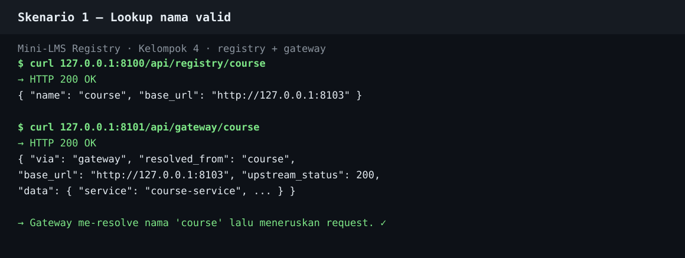
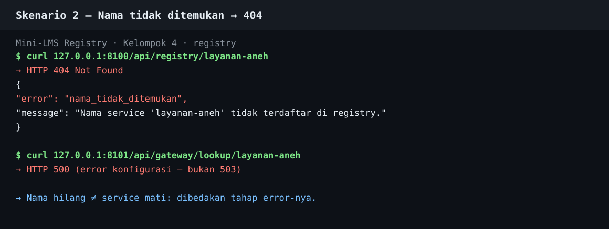
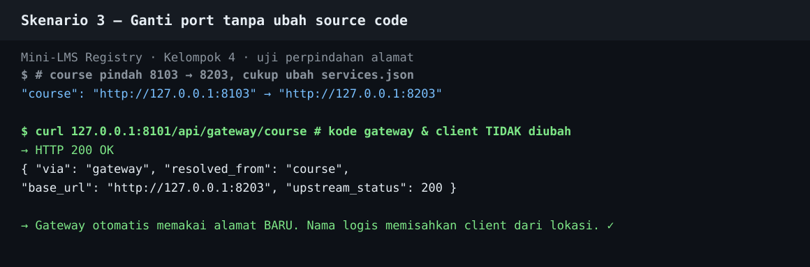

# Bukti Pengujian — Registry & Name Service

Kelompok 4 · Sistem Terdistribusi – Pilihan C · Pertemuan 7

Cara menjalankan ulang: `bash test_registry.sh` dari folder `pertemuan-7/`
(menyalakan registry :8100, gateway :8101, dan mock course :8103 sementara).
Alternatif: import `Mini-LMS-Registry.postman_collection.json` ke Postman.
Hasil terakhir: **8 lulus, 0 gagal**. Bukti mentah: `docs/bukti/`.

## Skenario 1 — Lookup nama valid ✅

- `GET /api/registry/course` → **200** `{name: course, base_url: 127.0.0.1:8103}`.
- `GET /api/gateway/lookup/course` → **200** (resolve via fungsi).
- `GET /api/gateway/course` → **200** — gateway me-resolve nama lalu
  meneruskan ke course service (`upstream_status: 200`).

## Skenario 2 — Nama tidak ditemukan ✅

- `GET /api/registry/layanan-aneh` → **404** `nama_tidak_ditemukan`.
- `GET /api/gateway/lookup/layanan-aneh` → **500** (error konfigurasi,
  dibedakan dari 503 service mati).

## Skenario 3 — Ganti port tanpa ubah source code ✅

- Course dipindah 8103 → 8203; hanya `services.json` yang diubah.
- `GET /api/gateway/course` → **200** dengan `base_url` baru (8203).
- Source code gateway & client **tidak diubah** — terbukti nama logis
  memisahkan client dari lokasi service.

## Skenario bonus — Service mati → 503 ✅

- Course dimatikan → `GET /api/gateway/course` → **503**
  `service_tidak_merespons` beserta `target` yang gagal.
  Bukti: `docs/bukti/s4-service-503.txt`.
  (Lookup tetap berhasil — sesuai materi, name service ≠ health check.)
